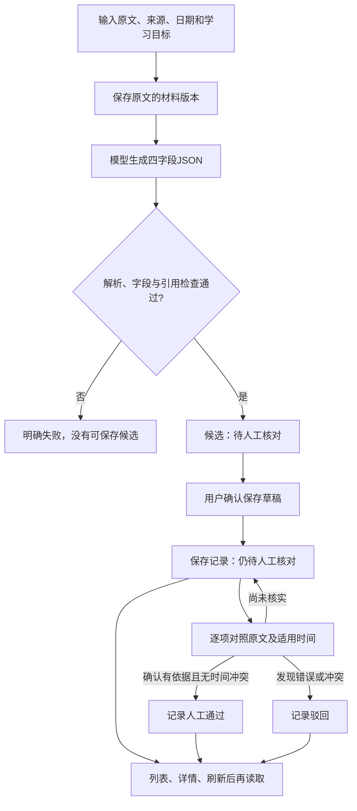

# 学习卡：做什么、怎么做、为什么

2026-10-13，依据当前完整参考实现核对。关联[学习任务](../tasks/2.2-result-review.md)。这是一份业务讲义，不是用户已掌握的证据。

## 我们在做什么

把一份有原文依据的备考材料，整理成可反复阅读、能回到原文核对、能明确保留未知信息的学习卡。模型帮助整理，人工判断依据与适用时间，程序记录和保存结果。

例如课堂材料中的“题型全部为客观题”，可以整理成重点和引句；原文没有给出客观题定义或未来考试日期，就保留未知。这个历史摘录不能直接成为未来考试规则。

卡片四字段：

| 字段 | 阅读时解决的问题 |
| --- | --- |
| summary摘要 | 这段原文主要说什么？ |
| keywords关键词 | 有哪些重点词可以回顾？ |
| evidence_quote引句 | 回到原文哪里核对？ |
| information_gap信息缺口 | 原文没有告诉我什么？ |

来源、日期、材料版本、归属、保存记录和审核状态属于外层业务数据，由程序组织；不要求模型生成这些控制信息。

## 当前完整参考应用怎样做

图中的生成是显式live主流程。本机默认演示使用已记录的历史真实候选回放，跳过新的模型请求；不能把回放说成刚刚生成。

1. 准备材料：用户输入标题、正文、来源和发布日期。未知日期保持未知；程序建立材料ID/版本，保存原文。学习目标说明这次重点想整理什么。
2. 生成候选：提示词要求只依据原文、输出四字段JSON；结构化包装器invoke调用模型，本地按LearningCard解析。
3. 程序检查：检查空正文/截断、解析错误、字段、空白关键词和引句是否存在。失败就明确返回错误，不展示为成功候选。
4. 保存草稿：通过上述检查仍是待人工核对的候选。当前页面先让用户保存，再为这个已保存记录填写人工审核；保存不调用模型。
5. 人工审核：把摘要中的判断逐项对应原文，核对关键词与缺口，确认历史材料的适用范围；引句位置由服务端再次核对。人工通过需要证据、完整核对确认和无时间冲突。人工状态只记录人的结论，不是程序证明全部语义正确。
6. 再次复习：从数据库读取相同卡片、原文和已有审核依据。刷新/重开不重新生成，也不因读取发模型请求。发现问题可以重新审核，旧审核请求不能覆盖更新后的审核版本。

## 为什么要分开这些步骤

- 原文与版本：卡片不是依据本身；保留它所依据的那份原文，才能回溯判断。没有日期不应补成当天日期。
- 固定四字段：代码能明确取summary或information_gap，不需要猜模型回答的标题，也可以检查缺字段/错误类型。
- 程序检查与人工核对：程序容易检查类型、长度和逐字引用，但引句存在不证明它支持摘要中的每个事实；人工仍需核对逻辑和时间。
- 候选与保存：模型生成成功只说明有候选，保存成功才有持久记录。用户选择是否留下；未保存候选会过期或随进程重启失效。
- 保存与审核：草稿可以先留下继续核对，但保存不自动提升为人工通过；pending/accepted/rejected在页面明确显示。
- 生成与读取：每次复习读已保存记录，内容稳定且不重复收费。保存失败先修复保存步骤，不自动再调用模型。

## 两种状态不要混淆

| 状态维度 | 值 | 含义 |
| --- | --- | --- |
| 是否持久保存 | 未保存候选/已保存记录 | 以后能不能从数据库重新读取 |
| 人工审核 | pending_manual_review | 尚未完成事实/时间核对 |
| 人工审核 | accepted | 人工确认当前内容版本可接受 |
| 人工审核 | rejected | 人工发现错误/冲突，保留记录但明确标为驳回 |

可以“已保存但待核对”，也可以“已保存且驳回”。保存和审核不是同一个动作。

## 你正在学哪里

2.1：LearningCard定义四字段规则。2.2：原文→结构化调用→程序检查→得到待人工核对候选。你打开的旧课程main.py/adapter.py只覆盖这段，不负责数据库保存或完整页面。

2.3-A接下来学习普通业务规则如何汇总人工结论，区分待核对、通过与驳回。完整参考代码已经提供数据库/API/页面，但这些后续能力还没有逐课验收；当前不一口气学习全部模块。

| 代码 | 在业务中的位置 |
| --- | --- |
| [schema.py](../../project_steps/02_01_card_schema/schema.py) | 定义卡片四字段 |
| [adapter.py](../../project_steps/02_02_structured_card/adapter.py) | 旧2.2提示词、包装器及结果检查 |
| [main.py](../../project_steps/02_02_structured_card/main.py) | 旧2.2组织生成与展示 |
| [domain.py](../../learning_app/domain.py) | 当前共享字段/引用/人工状态规则 |
| [service.py](../../learning_app/service.py) | 完整参考应用组织候选、保存、读取、审核 |

当前完整闭环仅本机教学demo，暂无真实账号认证或可上线多人平台；历史回放实测不替代新模板真实生成或完整材料质量验收。来源：[当前模块与API契约](../STAGE2_CODE_BLUEPRINT.md)、[参考交付实测](../tasks/STAGE2-001-complete-reference.md)。
